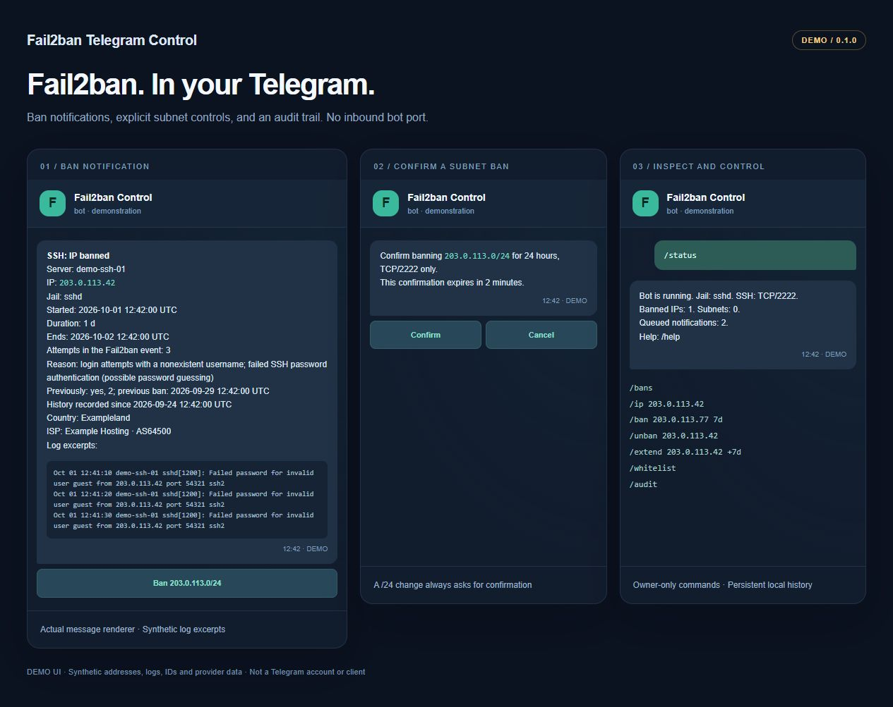
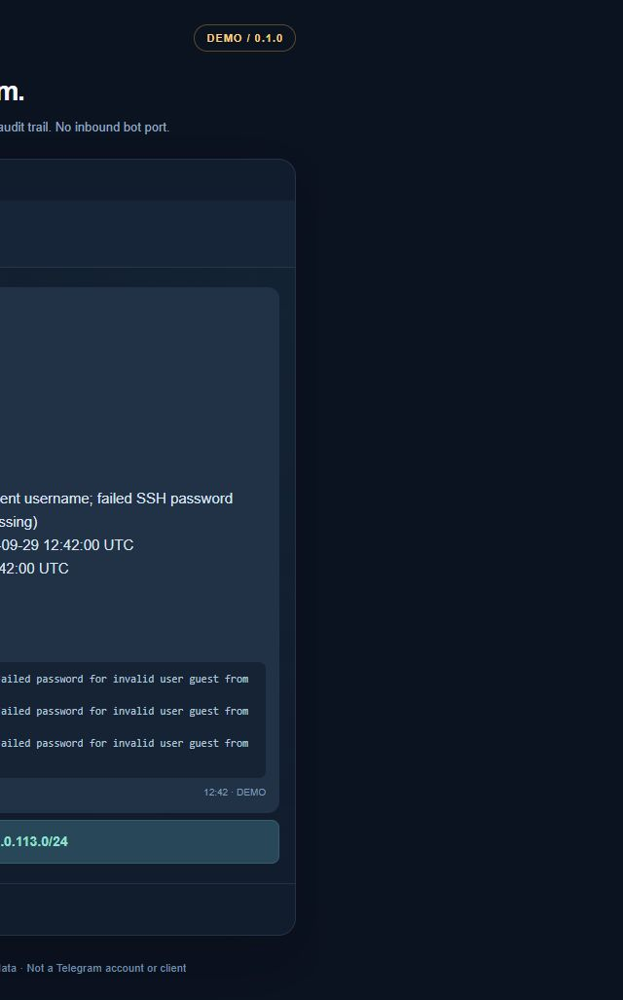
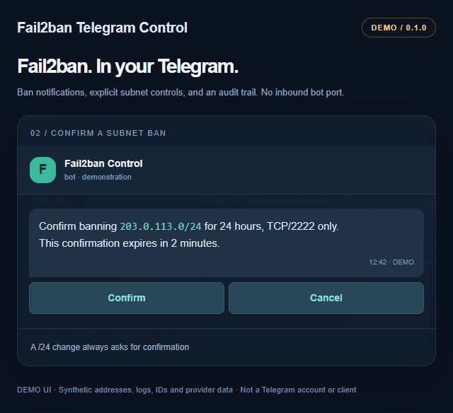
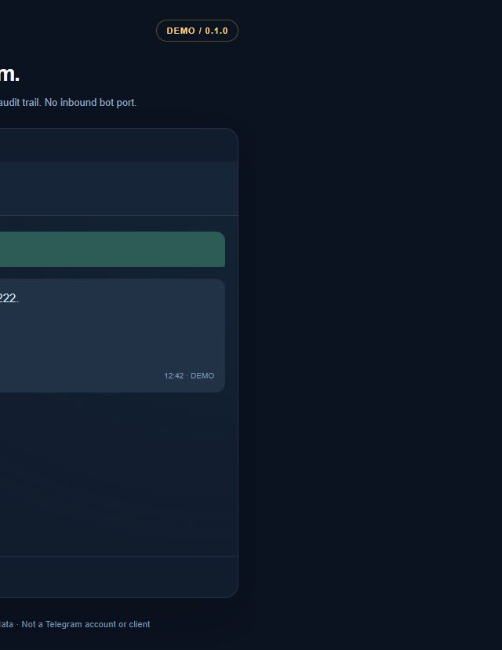

# Fail2ban Telegram Control

[Русская версия](README.ru.md) · [Commands](#commands) · [Security](SECURITY.md) · [Contributing](CONTRIBUTING.md)

[](https://github.com/rufpus/fail2ban-telegram-control/actions/workflows/ci.yml)

**See why an IP was banned. Manage SSH access from a private Telegram chat.**

A self-hosted integration for Fail2ban: contextual ban notifications, IP controls,
confirmed `/24` operations, a persistent whitelist and a local audit log.
English and Russian interfaces. No inbound port or webhook for the bot.



*Demo UI generated with the application's own message renderers. All addresses,
logs, IDs and provider data are synthetic. These are not screenshots of a real
Telegram account or an official Telegram client.*

## What it does

- Explains SSH filter matches in English or Russian, with up to three log lines.
- Shows the actual ban duration, expiry, event attempts, jail and server label.
- Records previous bans from the time the integration is installed.
- Supports manual IP bans, unbans and per-IP expiry changes without changing
  the jail's global `bantime` or temporarily lifting the IP's ban.
- Blocks `/24` networks on the configured SSH TCP ports after confirmation;
  kernel timeouts remove subnet bans even if the bot stops.
- Persists whitelist entries and removes matching individual IP bans.
- Stores notifications on disk and retries Telegram delivery after outages.
- Checks the private chat, owner ID, confirmation message and button expiry.

## Supported scope — version 0.1.0

| Component | Supported target |
| --- | --- |
| Server | Ubuntu **24.04 LTS**, systemd |
| Fail2ban | **1.0.2**, an enabled `sshd` jail |
| Firewall | Existing nftables multiport action restricted to the configured SSH ports |
| Python | System Python **3.12** on Ubuntu; core tests also run on 3.13 |
| Addresses | IPv4; subnet bans are `/24`, whitelist networks `/24`–`/32` |
| Telegram | One dedicated bot, one private chat, one owner |

Per-IP mutations use version-specific Fail2ban APIs. Untested Fail2ban versions
outside >=1.0.2,<1.1.0 produce a warning and require runtime API checks; other distributions and firewall backends are not advertised as
supported. Existing IPv6 protection remains with Fail2ban, but this bot does not
notify about or administer IPv6 bans.

The installer preserves existing jail actions and ban-time policy. It does not
replace `jail.local`, change your increment formula, or install its own SSH daemon.
Individual IP bans use the existing `sshd` actions; subnet rules use a separate
owned nftables table. The configured ports must match the jail's nftables ports.

## Installation

Run these steps on the target server, using its system Python. No `pip install`
is required. Keep an existing administrative SSH session available while checking
your firewall configuration.

### 1. Get the source and prerequisites

```sh
git clone https://github.com/rufpus/fail2ban-telegram-control.git
cd fail2ban-telegram-control
sudo apt update
sudo apt install -y python3 tzdata git fail2ban nftables openssh-server
```

**Already protecting SSH with Fail2ban?** Keep your existing jail configuration
and verify that its nftables action uses the actual SSH TCP ports. Skip the
following fresh-install example.

For a **new** Fail2ban installation only:

```sh
sudo install -m 0644 examples/sshd.local /etc/fail2ban/jail.d/telegram-sshd.local
sudo systemctl enable --now fail2ban
sudo fail2ban-client status sshd
```

The example uses `port = ssh` (22). If SSH listens on another port, edit that
new jail file first, for example `port = 2222` or `port = 22,2222`, then run
`sudo fail2ban-client reload sshd`. Do not overwrite an existing configuration
with the example. The installer checks port agreement and stops on a mismatch.

### 2. Create a dedicated Telegram bot

1. Open **[@BotFather](https://t.me/BotFather)** in Telegram and use `/newbot`.
2. Save its token privately; do not put it in a command, Git commit, browser URL
   or issue report.
3. Open the new bot in a **private** chat and send `/start`.
4. If you do not know your own Telegram ID, run:

```sh
python3 tools/get_chat_id.py
```

This helper prompts for the token without echoing it. It asks you to send a
one-time challenge to your bot and prints only the matching private chat ID.
It does not require a third-party ID-discovery bot. Do not run it alongside an
active bot poller; use a fresh dedicated bot for this setup.

### 3. Configure securely

```sh
sudo python3 setup_credentials.py
```

The wizard selects `en` or `ru`, a timezone, a server label, detected SSH ports,
the token and your private chat ID. The owner user ID must equal that chat ID.
It protects local interface addresses, loopback and the current SSH client
address automatically, and accepts additional protected IPs/CIDRs.

Country/ISP lookup is **off by default**. Enabling it sends banned public IPs
to `ipwho.is` over HTTPS; the token and SSH logs are not sent there.

Configuration is saved as root-owned mode `0600` at:

```text
/etc/fail2ban-telegram-control/config.json
```

[`config.example.json`](config.example.json) documents the fields. Its token,
zero IDs and documentation IP are placeholders, not a working configuration.

### 4. Check and install

```sh
sudo python3 installer.py doctor
sudo bash install.sh
sudo systemctl status fail2ban-telegram-control --no-pager
```

The installer backs up owned files and the SQLite database, validates Fail2ban
configuration, attaches its Python action and enables the systemd service.
An error triggers rollback of the files it changed; unrelated files are not
deleted. It does not restart the SSH daemon or flush Fail2ban's firewall table.

Open the bot and send `/status`, then `/help`. Commands also appear in Telegram's
command menu. All administration is limited to the configured owner.

## Commands

| Command | Behavior |
| --- | --- |
| `/help` | Help with examples |
| `/status` | Jail, ban counts and notification queue |
| `/bans [page]` | Active IP and subnet bans, ten entries per page |
| `/ip 203.0.113.42` | Live ban state, whitelist, local history and optional geo data |
| `/ban 203.0.113.42 [7d]` | Ban an IP immediately; default duration `24h` |
| `/unban 203.0.113.42` | Remove only its individual ban; report a remaining subnet ban |
| `/bansubnet 203.0.113.0/24 [2d]` | Confirm and ban a `/24`; default `24h` |
| `/unbansubnet 203.0.113.0/24` | Confirm and remove a subnet ban; keep individual bans |
| `/extend 203.0.113.42 7d` | Set expiry to seven days from receipt of the command, even if shorter |
| `/extend 203.0.113.42 +7d` | Add seven days to the existing expiry |
| `/whitelist [page]` | List persistent and mandatory protected entries |
| `/whitelist add 203.0.113.42` | Persistently whitelist and unban the IP |
| `/whitelist del 203.0.113.42` | Remove an optional entry; this does not ban the IP |
| `/audit [page]` | Administration results, timestamps and owner ID |

The `[]` above means optional: do not type brackets. A duration is a positive
integer with `s`, `m`, `h`, `d` or `w`. The maximum remaining duration is **5 weeks**.
Repeating `/ban` does not change the current expiry; use `/extend` explicitly.
`/extend` also accepts a canonical `/24`, with confirmation.

**Single IPs:** operations run immediately. **Subnets:** a message-bound,
single-use confirmation expires after two minutes. Expiry is calculated when a
command is received; confirming a command does not restart its clock. The ban
button in a notification applies 24 hours from confirmation.

Whitelist networks from `/24` to `/32` are accepted. Network changes require
confirmation; `/32` is treated as a single IP. If an added entry overlaps an
active subnet ban, the confirmation explicitly includes removing that entire
subnet ban. New subnet bans overlapping protected or whitelisted addresses are
rejected. Mandatory protection and original ignored addresses cannot be removed
through the bot. There is no `/unbanall` or arbitrary server command.

<details>
<summary>Detailed demo screenshots</summary>

| Ban notification | Subnet confirmation | Commands |
| --- | --- | --- |
|  |  |  |

All three images are generated demo UI with synthetic data.

</details>

## Files, reliability and privacy

| Path | Purpose |
| --- | --- |
| `/opt/fail2ban-telegram-control/` | Installed code |
| `/etc/fail2ban-telegram-control/config.json` | Private configuration |
| `/var/lib/fail2ban-telegram-control/state.sqlite3` | History, queue, operations, whitelist and audit |
| `/etc/fail2ban/action.d/telegram_control.py` | Owned Python action |
| `/etc/fail2ban/jail.d/zz-telegram-control-whitelist.local` | Symlink to the persistent whitelist in the state directory |
| `/var/backups/fail2ban-telegram-control/` | Installation backups |
| `inet f2b_telegram_control` | Owned nftables table for subnet bans |

The root service has `CAP_NET_ADMIN` and needs outbound HTTPS to Telegram.
Its writable paths are restricted by systemd. See [SECURITY.md](SECURITY.md) for
the authorization model and exactly which data leaves the server.

Notifications wait 15 seconds for Fail2ban's asynchronous incremental duration
update. Delivery is **at least once**: an ambiguous Telegram response can produce
a duplicate. Offline notifications remain on disk; expired bans are marked and
have no usable ban button. Commands older than five minutes are rejected after
an outage. Ordinary IP unbans are silent; subnet results, expirations and actionable
errors are reported.

History begins at installation, not before it. History, audit and queue data are
pruned after 30 days by the maintenance worker. Set `F2BT_RETENTION_DAYS`
(a positive integer) with a systemd service Environment override to change this TTL.
Live bans and pending notifications are retained until they can be safely removed.
Geo cache entries are removed when they expire or reach the retention TTL. Protect backups. A previous
ban count in the bot is independent of Fail2ban's own database retention.

Fail2ban 1.0.2 can remove Python actions during a jail reload. The integration
reattaches its owned action on the next request or maintenance check (every 15
seconds); existing nftables enforcement remains in place. Ban state is reconciled
with live tickets. Subnet rules recover their remaining duration after a worker
restart, and kernel expiry works without Telegram connectivity.

## Maintenance and troubleshooting

```sh
sudo journalctl -u fail2ban-telegram-control -n 50 --no-pager
sudo fail2ban-client status sshd
sudo fail2ban-client get sshd actions
sudo nft list table inet f2b_telegram_control
```

| Problem | Check |
| --- | --- |
| No Telegram messages | Send `/start`; verify private ID, token, outbound HTTPS and a dedicated bot without a webhook |
| Commands denied | `chat_id` and `user_id` must identify the same configured private-chat owner |
| Installation stops | Read the doctor output; confirm Ubuntu/Fail2ban version, nftables action and matching SSH ports |
| A button expired | Request a fresh action; confirmations last two minutes |
| `/unban` did not restore access | Inspect `/ip IP` for a subnet ban; unban the `/24` separately |
| No country/ISP | Enable `geoip` if desired; disabled lookup, private/documentation addresses, rate limits and provider failure yield no data |

To change the language, timezone, token or SSH ports, rerun the installed wizard
and restart the service. If ports changed, update the `sshd` jail too and run
doctor from a source checkout. Fixed protected addresses are captured as a
baseline; removing mandatory protection requires deliberate manual maintenance
of the configuration and saved baseline, not a Telegram command.

```sh
sudo python3 /opt/fail2ban-telegram-control/setup_credentials.py
sudo systemctl restart fail2ban-telegram-control
```

For code updates, review a new checkout and run its installer. Backups remain
outside the repository. To disable and uninstall the integration:

```sh
sudo bash /opt/fail2ban-telegram-control/uninstall.sh
```

Uninstall removes the owned service, Python action, whitelist include and subnet
rules, restoring baseline ignored entries. Individual Fail2ban bans remain.
Configuration, code, state and backups are retained for recovery.

## Development and CI

```sh
python3 -m unittest discover -v
python3 tools/check_release.py
```

Unit tests need no credentials or root. Linux CI additionally starts real
Fail2ban 1.0.2 and nftables in a disposable Ubuntu container, testing custom ports,
per-ticket durations, whitelist persistence, confirmation flows and kernel expiry.
The container has no network at test time. Systemd-file rollback is covered by
the Linux unit suite; CI does not boot an entire Ubuntu server under systemd.

The publication scan rejects candidate tokens, private keys, runtime artifacts
and non-documentation IPv4 addresses. Demo images are reproducible from
`tools/build_demo.py`; no private screenshots or logs are included.

## License

[MIT](LICENSE) for this project's own code. Dependencies retain their respective
licenses; see [third-party notices](THIRD_PARTY_NOTICES.md).

Outbox: text exceeding 4096 UTF-16 units (including HTML markup) is rejected.
Only network/HTTP 5xx failures retry with exponential backoff, at most 8 attempts.
Other errors, including HTTP 400 and 429, and exhausted retries are retained with
`status=failed` for diagnosis until the retention TTL. Inspect the service journal.
TODO: choose between explicit manual replay and owner-approved replay of dead letters;
no automatic replay is performed.
