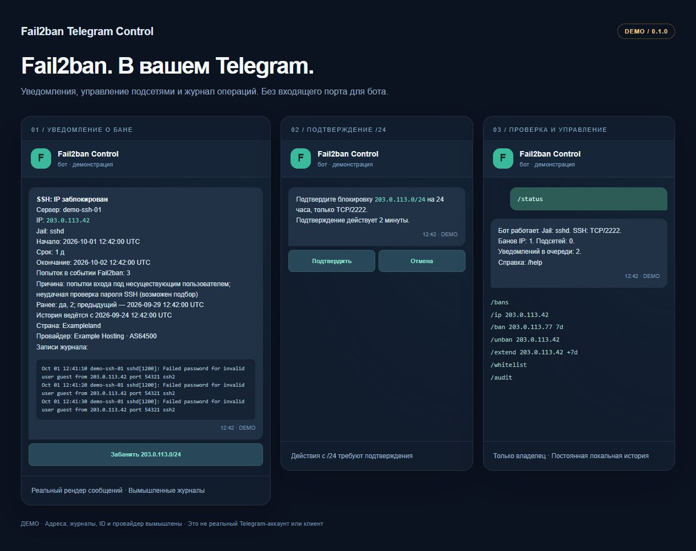
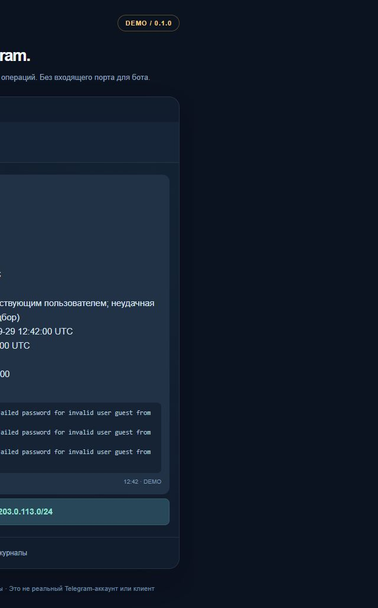
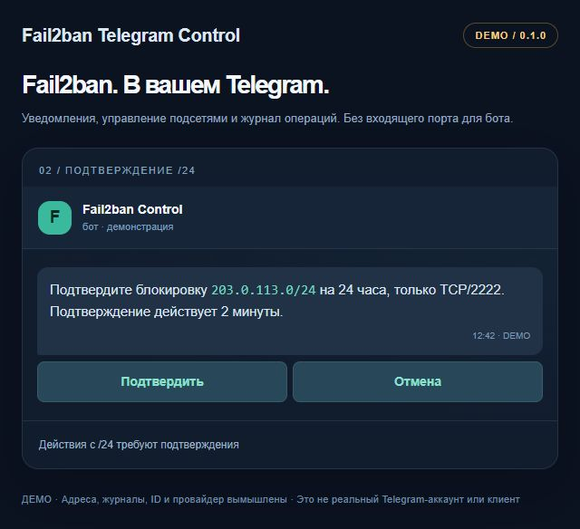
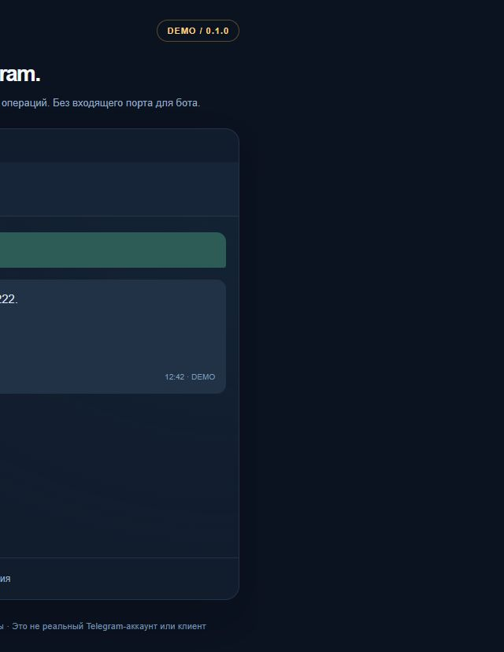

# Fail2ban Telegram Control

[English](README.md) · [Команды](#команды) · [Безопасность](SECURITY.md) · [Участие в разработке](CONTRIBUTING.md)

[](https://github.com/rufpus/fail2ban-telegram-control/actions/workflows/ci.yml)

**Узнайте, почему заблокирован IP. Управляйте доступом к SSH из личного Telegram-чата.**

Интеграция для самостоятельной установки: подробные уведомления Fail2ban,
управление IP, подтверждение действий с `/24`, постоянный белый список и
локальный журнал операций. Английский и русский интерфейсы. Боту не нужны
входящий порт и webhook.



*Демонстрационный интерфейс использует настоящие функции формирования сообщений.
Адреса, журналы, ID и данные провайдера вымышлены. Это не скриншоты реального
Telegram-аккаунта или официального клиента Telegram.*

## Возможности

- Объяснение срабатывания SSH-фильтра на русском или английском и до трёх строк журнала.
- Фактический срок бана, время окончания, число попыток в событии, jail и название сервера.
- История предыдущих банов с момента установки интеграции.
- Ручной бан, разбан и изменение срока отдельного IP без изменения общего
  `bantime` jail и без временного снятия блокировки.
- Блокировка `/24` на настроенных TCP-портах SSH после подтверждения;
  таймер ядра снимает её, даже если бот остановлен.
- Постоянный белый список со снятием индивидуальных банов разрешённых адресов.
- Очередь уведомлений на диске с повторной доставкой после сбоев Telegram.
- Проверка личного чата, user ID владельца, сообщения подтверждения и срока кнопки.

## Поддерживаемое окружение — версия 0.1.0

| Компонент | Поддерживаемый вариант |
| --- | --- |
| Сервер | Ubuntu **24.04 LTS**, systemd |
| Fail2ban | **1.0.2**, включённый jail `sshd` |
| Межсетевой экран | Существующая nftables-action типа multiport с настроенными SSH-портами |
| Python | Системный Python **3.12** в Ubuntu; основные тесты также выполняются на 3.13 |
| Адреса | IPv4; бан подсетей `/24`, белый список `/24`–`/32` |
| Telegram | Отдельный бот, один личный чат, один владелец |

Изменение срока IP использует внутренние API конкретной версии Fail2ban.
Диапазон совместимости: >=1.0.2,<1.1.0; вне его выводится WARN.
Внутренние API проверяются при обращении; при несовместимости операция
отклоняется с диагностикой. Поддержка других ОС и firewall не заявляется.
Существующую защиту IPv6 продолжает обеспечивать Fail2ban, но бот не отправляет
уведомления об IPv6-банах и не управляет ими.

Установщик сохраняет действующие action и политику сроков jail. Он не заменяет
`jail.local`, не меняет формулу увеличения бана и не устанавливает собственный
SSH-демон. Индивидуальные баны используют действующие action `sshd`, а подсети —
отдельную таблицу nftables. Порты в настройках должны совпадать с портами nftables-action jail.

## Установка

Выполняйте команды на целевом сервере системным Python. Установка пакетов через
`pip` не требуется. Во время проверки firewall оставьте доступный административный
SSH-сеанс.

### 1. Исходники и зависимости

```sh
git clone https://github.com/rufpus/fail2ban-telegram-control.git
cd fail2ban-telegram-control
sudo apt update
sudo apt install -y python3 tzdata git fail2ban nftables openssh-server
```

**Fail2ban уже защищает SSH?** Сохраните существующую конфигурацию и проверьте,
что её nftables-action использует реальные TCP-порты SSH. Пропустите следующий
пример для новой установки.

Только для **новой** установки Fail2ban:

```sh
sudo install -m 0644 examples/sshd.local /etc/fail2ban/jail.d/telegram-sshd.local
sudo systemctl enable --now fail2ban
sudo fail2ban-client status sshd
```

В примере задано `port = ssh`, то есть 22. Если SSH работает на другом порту,
сначала отредактируйте новый файл jail: например, `port = 2222` или
`port = 22,2222`. Затем выполните `sudo fail2ban-client reload sshd`.
Не перезаписывайте этим примером существующую конфигурацию. Установщик проверит
совпадение портов и остановится при расхождении.

### 2. Отдельный Telegram-бот

1. Откройте **[@BotFather](https://t.me/BotFather)** и выполните `/newbot`.
2. Сохраните токен в приватном месте. Не вставляйте его в команду, Git-коммит,
   URL браузера или issue.
3. Откройте нового бота в **личном** чате и отправьте `/start`.
4. Если вы не знаете собственный Telegram ID, выполните:

```sh
python3 tools/get_chat_id.py
```

Помощник запросит токен скрытым вводом и предложит отправить боту одноразовую
проверочную фразу. Он покажет ID только совпавшего личного чата. Сторонний бот
для определения ID не нужен. Не запускайте помощник одновременно с работающим
обработчиком Telegram: для первой настройки используйте нового отдельного бота.

### 3. Безопасная настройка

```sh
sudo python3 setup_credentials.py
```

Мастер предлагает выбрать `en` или `ru`, часовой пояс, название сервера,
обнаруженные SSH-порты, токен и ID личного чата. User ID владельца должен
совпадать с chat ID. Локальные адреса интерфейсов, loopback и текущий адрес
SSH-клиента защищаются автоматически. Можно добавить свои защищённые IP/CIDR.

Определение страны и провайдера **по умолчанию отключено**. При включении
заблокированные публичные IP передаются `ipwho.is` по HTTPS. Токен и строки
SSH-журналов этому сервису не отправляются.

Конфигурация сохраняется с владельцем root и правами `0600`:

```text
/etc/fail2ban-telegram-control/config.json
```

Поля описаны в [`config.example.json`](config.example.json). Токен, нулевые ID и
документационный IP в примере — заглушки, а не рабочая конфигурация.

### 4. Проверка и установка

```sh
sudo python3 installer.py doctor
sudo bash install.sh
sudo systemctl status fail2ban-telegram-control --no-pager
```

Установщик делает резервную копию принадлежащих проекту файлов и SQLite-базы,
проверяет конфигурацию Fail2ban, подключает Python-action и включает службу
systemd. При ошибке выполняется откат изменённых файлов; посторонние файлы не
удаляются. SSH-демон не перезапускается, таблица firewall Fail2ban не очищается.

В Telegram отправьте `/status`, затем `/help`. Команды появятся и в меню бота.
Управление доступно только настроенному владельцу.

## Команды

| Команда | Поведение |
| --- | --- |
| `/help` | Справка с примерами |
| `/status` | Jail, число банов и очередь уведомлений |
| `/bans [страница]` | Действующие баны IP и подсетей, по десять записей |
| `/ip 203.0.113.42` | Текущий бан, белый список, локальная история и необязательные геоданные |
| `/ban 203.0.113.42 [7d]` | Немедленный бан IP; по умолчанию `24h` |
| `/unban 203.0.113.42` | Снять только индивидуальный бан и сообщить об оставшемся бане подсети |
| `/bansubnet 203.0.113.0/24 [2d]` | Бан `/24` после подтверждения; по умолчанию `24h` |
| `/unbansubnet 203.0.113.0/24` | Разбан `/24` после подтверждения; отдельные баны IP сохраняются |
| `/extend 203.0.113.42 7d` | Окончание через семь суток от получения команды, в том числе сокращение срока |
| `/extend 203.0.113.42 +7d` | Добавить семь суток к текущему окончанию |
| `/whitelist [страница]` | Постоянные и обязательные защищённые записи |
| `/whitelist add 203.0.113.42` | Постоянно разрешить IP и снять его бан |
| `/whitelist del 203.0.113.42` | Удалить необязательную запись; это не банит IP |
| `/audit [страница]` | Результаты операций, время и ID владельца |

Квадратные скобки означают необязательный аргумент — вводить их не нужно. Срок:
положительное целое число с `s`, `m`, `h`, `d` или `w`. Максимальный оставшийся
срок — **5 недель**. Повторный `/ban` не меняет окончание: используйте `/extend`.
Команда `/extend` также принимает корректный адрес сети `/24` и требует подтверждения.

**Один IP:** операции выполняются сразу. **Подсети:** одноразовое подтверждение
привязано к сообщению и действует две минуты. Окончание рассчитывается при
получении команды; подтверждение не начинает отсчёт заново. Кнопка бана в
уведомлении устанавливает 24 часа с момента подтверждения.

В белый список принимаются `/24`–`/32`. Изменения подсетей требуют подтверждения;
`/32` считается одним IP. Если добавляемая запись пересекается с действующим
баном подсети, подтверждение явно включает снятие бана всей этой подсети.
Новые баны подсетей, пересекающих защищённые или белые адреса, отклоняются.
Обязательную защиту и исходные игнорируемые адреса нельзя удалить через бота.
Команд `/unbanall` и произвольного выполнения команд сервера нет.

<details>
<summary>Подробные демо-скриншоты</summary>

| Уведомление | Подтверждение подсети | Команды |
| --- | --- | --- |
|  |  |  |

Все изображения показывают демонстрационный интерфейс с вымышленными данными.

</details>

## Файлы, надёжность и конфиденциальность

| Путь | Назначение |
| --- | --- |
| `/opt/fail2ban-telegram-control/` | Установленный код |
| `/etc/fail2ban-telegram-control/config.json` | Приватная конфигурация |
| `/var/lib/fail2ban-telegram-control/state.sqlite3` | История, очередь, операции, белый список и аудит |
| `/etc/fail2ban/action.d/telegram_control.py` | Python-action проекта |
| `/etc/fail2ban/jail.d/zz-telegram-control-whitelist.local` | Ссылка на постоянный белый список в каталоге состояния |
| `/var/backups/fail2ban-telegram-control/` | Резервные копии установки |
| `inet f2b_telegram_control` | Отдельная таблица nftables для подсетей |

Служба работает от root с `CAP_NET_ADMIN` и использует исходящие HTTPS-запросы
к Telegram. Пути записи ограничены средствами systemd. Модель авторизации и
точный перечень передаваемых с сервера данных описаны в [SECURITY.md](SECURITY.md).

Уведомление ждёт 15 секунд, чтобы учесть асинхронное увеличение срока Fail2ban.
Доставка — **как минимум один раз**: если ответ Telegram потерян, возможен
дубликат. Офлайн-уведомления сохраняются; истёкшие баны отмечаются, а действующей
кнопки блокировки у них нет. Команды старше пяти минут после восстановления
связи отклоняются. Обычные разбаны IP не создают сообщений; действия с
подсетями, их истечение и ошибки, требующие внимания, сопровождаются сообщениями.

История начинается с установки. События, аудит, истёкший геокэш и завершённые
уведомления очищаются через 30 дней. Срок можно изменить положительным целым
`Environment=F2BT_RETENTION_DAYS=60` в systemd override и перезапуском службы.
Активные баны и недоставленные уведомления сохраняются до безопасной очистки.
Геокэш удаляется при истечении собственного срока или TTL хранения.
Очистка работает и при недоступности Fail2ban.
История повторов ограничена этим сроком; защищайте резервные копии.
Счётчик банов бота не зависит от срока хранения собственной базы Fail2ban.

Fail2ban 1.0.2 может удалить Python-action при перечитывании jail. Интеграция
восстанавливает свою action при следующем обращении или плановой проверке
каждые 15 секунд; действующие правила nftables продолжают работать. Состояние
истории сверяется с реальными билетами бана. После перезапуска службы подсети
восстанавливаются только на оставшийся срок, а таймер ядра работает без связи с Telegram.

## Обслуживание и диагностика

```sh
sudo journalctl -u fail2ban-telegram-control -n 50 --no-pager
sudo fail2ban-client status sshd
sudo fail2ban-client get sshd actions
sudo nft list table inet f2b_telegram_control
```

| Проблема | Что проверить |
| --- | --- |
| Нет сообщений | `/start`, личный ID, токен, исходящий HTTPS и отдельный бот без webhook |
| Команды отклоняются | `chat_id` и `user_id` должны относиться к одному настроенному владельцу личного чата |
| Установка остановилась | Вывод doctor: версии Ubuntu/Fail2ban, nftables-action и совпадение SSH-портов |
| Подтверждение истекло | Запросите действие заново; срок подтверждения — две минуты |
| `/unban` не восстановил доступ | Проверьте `/ip IP`: возможно, остаётся бан `/24`; снимите его отдельно |
| Нет страны/провайдера | При необходимости включите `geoip`; отключение, непубличные/документационные адреса, лимиты и сбои сервиса дают «нет данных» |

Чтобы изменить язык, часовой пояс, токен или SSH-порты, повторите мастер и
перезапустите службу. При изменении портов также обновите jail `sshd` и
запустите doctor из каталога исходников. Защищённые адреса сохраняются как
обязательная база: её удаление требует осознанного ручного изменения
конфигурации и сохранённой базы, а не команды Telegram.

```sh
sudo python3 /opt/fail2ban-telegram-control/setup_credentials.py
sudo systemctl restart fail2ban-telegram-control
```

Для обновления кода проверьте новую копию исходников и запустите её установщик.
Резервные копии остаются вне репозитория. Отключение и удаление интеграции:

```sh
sudo bash /opt/fail2ban-telegram-control/uninstall.sh
```

Удаляются служба, Python-action, include белого списка и правила подсетей;
восстанавливаются исходные игнорируемые адреса. Индивидуальные баны Fail2ban
сохраняются. Конфигурация, код, состояние и резервные копии остаются для восстановления.

## Разработка и CI

```sh
python3 -m unittest discover -v
python3 tools/check_release.py
```

Для unit-тестов не нужны секреты и root. Linux CI дополнительно запускает
настоящие Fail2ban 1.0.2 и nftables в одноразовом контейнере Ubuntu: проверяются
нестандартные порты, сроки отдельных IP, постоянный белый список, подтверждения
и таймеры ядра. Во время тестирования у контейнера нет сети. Откат файлов
systemd проверяется Linux unit-тестом; полный сервер Ubuntu с systemd в CI не загружается.

Проверка публикации отклоняет возможные токены, закрытые ключи, рабочие базы и
журналы, а также IPv4 вне документационных диапазонов. Демо воспроизводится
скриптом `tools/build_demo.py`. Приватные скриншоты и журналы в проект не входят.

## Лицензия

[MIT](LICENSE) для собственного кода проекта. Зависимости сохраняют свои
лицензии — см. [уведомления о сторонних компонентах](THIRD_PARTY_NOTICES.md).

Outbox: текст длиннее 4096 единиц UTF-16 (включая HTML) отклоняется.
Сетевые ошибки и HTTP 5xx повторяются с экспоненциальной задержкой, максимум
8 попыток. Остальные ошибки, включая HTTP 400 и 429, получают `status=failed`
и хранятся до TTL; подробности — в журнале службы.
TODO: выбрать ручной повтор dead-letter или повтор с подтверждением владельца;
автоматический повтор таких сообщений не выполняется.

Предупреждения о dead-letter агрегируются не чаще раза в пять минут; одновременно
ожидает доставки не более одной сводки. Курсор сохраняется после перезапуска.
Сводка имеет тот же лимит попыток, а её неудача не создаёт следующую сводку.
При недоступном Telegram состояние видно в журнале и счётчике failed в `/status`
после восстановления связи; гарантировать доставку самой сводки невозможно.

### Проверка настоящего systemd-юнита

Отдельный CI-job на Ubuntu 24.04 требует systemd в PID 1 и запускает штатный
unit. Тестовый drop-in добавляет только `ExecStartPre` для доступа к настоящему
сокету Fail2ban/Python-action и БД, а также `IPAddressDeny=any`: доставка Telegram
здесь не проверяется. Основной процесс бота работает со штатными ограничениями
ProtectSystem, capabilities и семейств адресов. Отсутствие systemd явно провалит
job; Docker-интеграция сама по себе sandbox systemd не эмулирует.

Это проверка запуска службы, а не перезагрузки VM или всех дистрибутивов.
После обновления на своём Ubuntu-сервере выполните:

```bash
sudo systemd-analyze verify /etc/systemd/system/fail2ban-telegram-control.service
sudo systemctl restart fail2ban-telegram-control
sudo systemctl is-active fail2ban-telegram-control
sudo journalctl -u fail2ban-telegram-control --since '-5 minutes' --no-pager
```

Затем отправьте `/status` и `/ip 198.18.0.42`: они проверяют реальный сокет.
Повторите после плановой перезагрузки для проверки порядка запуска. Причину
ошибок sandbox/сокета ищите в журнале, не отключая защиту службы.

### `/extend` после рестарта Fail2ban

Срок индивидуального IP меняется в тикете Fail2ban в памяти; новая запись бана
в `fail2ban.sqlite3` намеренно не добавляется. Рестарт только бота сохраняет срок,
пока Fail2ban продолжает работать. При рестарте Fail2ban может восстановиться
исходный записанный срок, либо IP уже не восстановится, если исходная запись
истекла. Продлённый бан может завершиться раньше указанного ботом; сокращённый
бан, наоборот, может восстановиться на более долгий срок.

Бот не пере-банивает адреса автоматически по истории: это могло бы отменить
намеренный разбан администратора или новую политику whitelist/jail. После
рестарта Fail2ban проверьте `/ip IP` или `/bans`; при действующем бане повторите
`/extend IP СРОК`, при отсутствующем — при необходимости явно `/ban IP СРОК`.
Вариант `+СРОК` прибавляется к фактическому текущему дедлайну.
Собственные баны `/24` хранятся в SQLite интеграции и восстанавливаются через
сверку nftables после рестарта бота; это ограничение относится к индивидуальным IP.

Проверки разработки: ruff, mypy и pytest-cov из `requirements-dev.txt`.
CI требует минимум 65% покрытия runtime-кода без root (измерено 65,12%
на Windows; Linux дополнительно проверяет POSIX rollback). Область проверок
и команды описаны в CONTRIBUTING.md. Службе pip-зависимости не добавлены.

Общие константы и подключение SQLite вынесены в независимый `f2bcore.py`.
Импорт `f2bmanage` больше не загружает worker: его сервисы импортируются только
при вызове функций. Прежний CLI входит в именованный модуль обычным импортом,
без подмены `sys.modules`. Это минимальное устранение верхнеуровневого цикла;
связи сервисов при вызовах и глобальные SETTINGS/контекст переводов сохранены.
